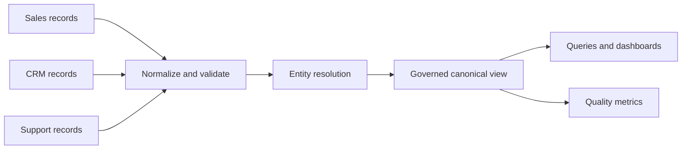

# Modern Extension Plan (2026)

This document is **new portfolio work**. It does not describe work completed in the original academic paper.

## Research question

When heterogeneous operational systems contain duplicate, incomplete, and inconsistent customer records, how effectively can a governed integrated view improve record quality and analyst usability, and at what cost in complexity and latency?

## Proposed pipeline

This is a **local demonstration of integrated views**, not a production data federation engine.

## Evaluation

- **Completeness:** non-null required fields before and after consolidation.
- **Duplicate detection:** number of matching candidate entities and unresolved ambiguous cases.
- **Entity resolution:** precision/recall against a small synthetic ground truth.
- **Correctness:** canonical records retain source lineage and do not merge distinct people on names alone.
- **Performance:** query latency at larger scale, deferred until realistic benchmarking data exists.
- **Governance:** documentation for ownership, access, provenance, change tracking, and quality policy.

## Risks

Matching people by names alone may cause false positives. Real-world personal information must not be included in a public demonstration. The synthetic prototype intentionally uses exact normalized email identifiers, and **does not claim to solve general entity resolution**.

## Research extensions

A separate research question could investigate whether governed enterprise knowledge improves grounding, source attribution, and consistency in retrieval-augmented language models. That investigation would require new experiments, baselines, and metrics; it is **not** claimed by the original manuscript.

## Repository maturity

- Original text preserved: completed
- Prototype with synthetic data: included as a small illustrative baseline
- Experiments on external real-world data: not performed
- Comparative architecture benchmarks: not performed
